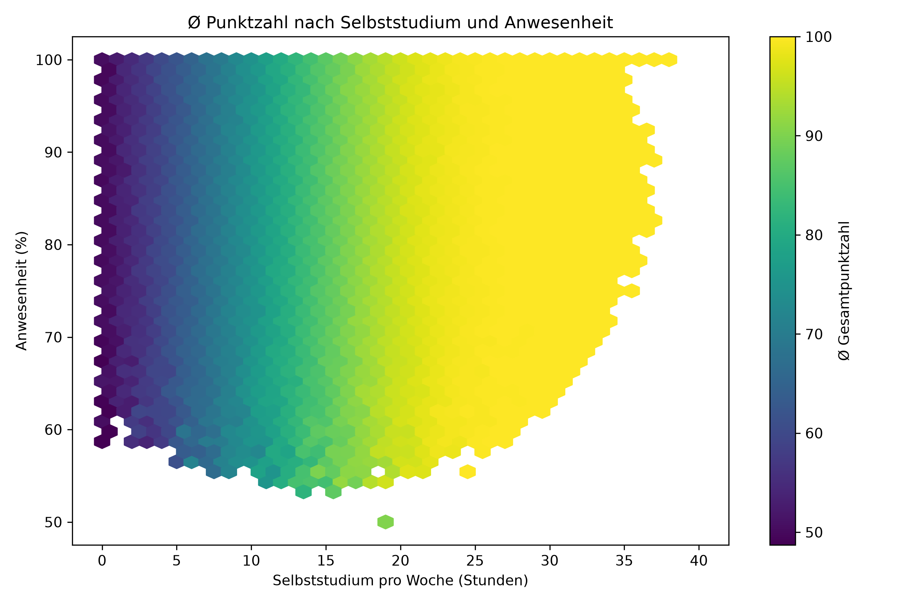

# Student Performance Analysis

Explorative Analyse eines Datensatzes mit 1.000.000 Studierenden: Wie hängen **Selbststudium**, **Anwesenheit** und **Gesamtpunktzahl** zusammen?



## Inhalt

- [Datensatz](#datensatz)
- [Vorgehen](#vorgehen)
- [Ergebnisse](#ergebnisse)
- [Installation und Nutzung](#installation-und-nutzung)
- [Projektstruktur](#projektstruktur)
- [Grenzen der Analyse](#grenzen-der-analyse)

## Datensatz

Quelle: `<Link zum Datensatz, z. B. Kaggle>`

| Spalte | Beschreibung |
|---|---|
| `student_id` | Eindeutige ID |
| `weekly_self_study_hours` | Selbststudium pro Woche (Stunden) |
| `attendance_percentage` | Anwesenheit (%) |
| `class_participation` | Mitarbeit im Unterricht |
| `total_score` | Gesamtpunktzahl (0–100) |
| `grade` | Note (A, B, ...) |

## Vorgehen

Die Analyse folgt einer kleinen ETL-Struktur mit drei Funktionen:

1. **`transform_data`**: erzeugt zwei kategoriale Spalten mit `pd.cut`
   - `niveau`: Needs Improvement (≤ 49), Good (50–79), Excellent (80–100)
   - `att_group`: Low (≤ 75 %), Mid (76–90 %), Excellent (> 90 %)
2. **`analyse_data`**: aggregiert pro Anwesenheitsgruppe (Ø Selbststudium, Ø Punktzahl, Anzahl) und berechnet die Korrelationsmatrix
3. **`load_result`**: speichert die Zusammenfassung als CSV

Visualisiert wird mit einem **Hexbin-Plot** über alle 1 Mio. Zeilen. Die Achsen zeigen Selbststudium und Anwesenheit, die Farbe die durchschnittliche Gesamtpunktzahl pro Zelle. Zellen mit weniger als 20 Datenpunkten werden ausgeblendet (`mincnt=20`). Ein normales Streudiagramm wäre bei dieser Datenmenge unleserlich.

## Ergebnisse

- **Selbststudium** hat den deutlichsten Zusammenhang mit der Punktzahl: Bei 0 Stunden liegt der Durchschnitt bei etwa 50 Punkten und steigt mit den Lernstunden kontinuierlich an.
- Ab etwa **25 Wochenstunden** erreicht die Ø Punktzahl das Maximum von 100.
- Die **Anwesenheit** zeigt im Plot einen deutlich schwächeren Effekt: Die Farbverläufe verlaufen überwiegend entlang der Selbststudium-Achse, also vertikal über alle Anwesenheitswerte hinweg konstant.
- Niedrige Anwesenheit (unter ca. 60 %) kommt nur selten vor, und dort sind die Zellen dünn besetzt.

## Installation und Nutzung

```bash
git clone https://github.com/<user>/<repo>.git
cd <repo>
pip install -r requirements.txt
```

Datensatz herunterladen und den Pfad in der Konfiguration bzw. im Notebook anpassen:

```python
df = pd.read_csv("<pfad>/student_performance.csv")
```

Danach das Notebook `<notebook-name>.ipynb` ausführen oder die Pipeline als Skript starten:

```python
df = transform_data(df)
summary, corr = analyse_data(df)
load_result(summary)
```

Ausgabe: `analysis_results.csv` und die Plots als PNG (`hexbin_3_variablen.png`).

**Abhängigkeiten:** `pandas`, `numpy`, `matplotlib`, `seaborn`

## Projektstruktur

```
.
├── README.md
├── requirements.txt
├── <notebook-name>.ipynb
├── analysis_results.csv
└── images/
    └── hexbin_3_variablen.png
```

## Grenzen der Analyse

- **Deckeneffekt:** `total_score` ist bei 100 gekappt. Dadurch sind Korrelationen abgeschwächt, und ab ca. 25 Lernstunden lassen sich Unterschiede nicht mehr auflösen.
- **Korrelation ≠ Kausalität:** Die Auswertung ist rein deskriptiv.
- **Dünn besetzte Randbereiche:** Aussagen zu sehr niedriger Anwesenheit stützen sich auf wenige Datenpunkte.
- Die Klassengrenzen von `niveau` und `att_group` sind eine eigene Festlegung und beeinflussen die Gruppenmittelwerte.

## Lizenz

`<free>`


